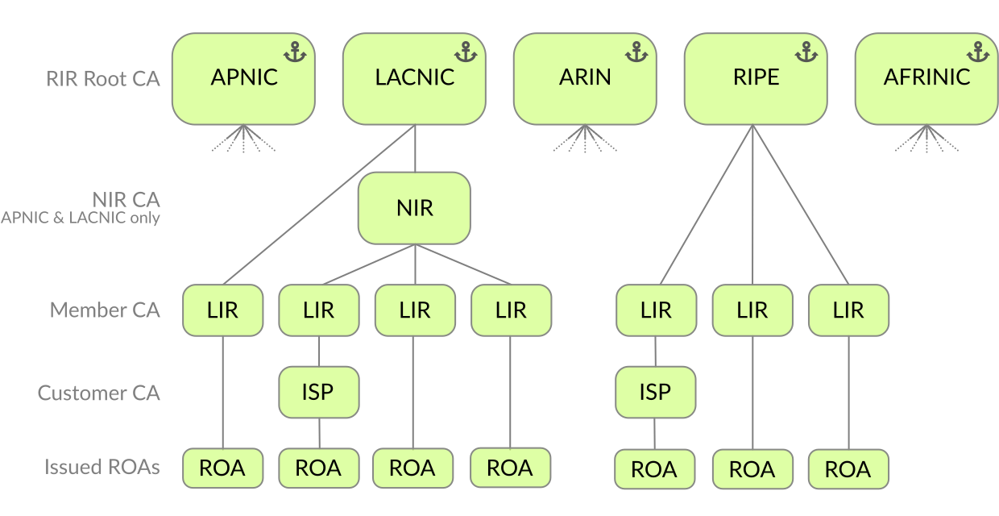

Data Processing
===============

Fetching
--------

There are two protocols in use to transport :term:`RPKI <Resource Public Key
Infrastructure (RPKI)>` data: rsync and the :term:`RPKI
Repository Delta Protocol (RRDP)`, which relies on HTTPS. :term:`RRDP <RPKI Repository
Delta Protocol (RRDP)>` was designed to
be the successor to rsync in the :term:`RPKI <Resource Public Key Infrastructure (RPKI)>`.
As all :term:`RPKI <Resource Public Key Infrastructure (RPKI)>` :term:`repositories
<Repository>` currently
advertise support for both protocols, Routinator will prefer :term:`RRDP <RPKI Repository
Delta Protocol (RRDP)>` if
available. 

In the :term:`RPKI <Resource Public Key Infrastructure (RPKI)>`, the certificate hierarchy
follows the same structure as the
:term:`Internet number resource <Internet number resources>` allocation hierarchy.
Routinator starts traversing the
tree by connecting to the :term:`trust anchors <Trust Anchor (TA)>` of the
:term:`Regional Internet Registries <Regional Internet Registry (RIR)>` (:term:`RIRs
<Regional Internet Registry (RIR)>`). Along the way Routinator will find several
pointers to child :term:`publication points <Publication Point>`, such as the
ones operated by National Internet Registries (NIRs), Local Internet Registries
(LIRs) and organisations running delegated :term:`RPKI <Resource Public Key Infrastructure
(RPKI)>`. Each pointer explicitly states
if :term:`RRDP <RPKI Repository Delta Protocol (RRDP)>` is offered in addition to rsync.

    The RPKI hierarchy

As a precaution, Routinator will not accept rsync and HTTPS URIs from
:term:`RPKI repositories <Repository>` with dubious hostnames. In particular, it
will reject the name *localhost*, URIs that consist of IP addresses, and
hostnames that contain an explicit port. You can change this behaviour with the
:option:`--allow-dubious-hosts` option.

RRDP URLs and Redirects
"""""""""""""""""""""""

Routinator uses the notification URL in the :term:`CA <Certification authority (CA)>`
certificate to determine
which :term:`HTTPS origin <Same origin>` it will contact for that :term:`repository`. This
prevents a
:term:`notification file <RRDP notification file>` or an HTTP redirect from directing the
validator to another
server to retrieve :term:`RRDP <RPKI Repository Delta Protocol (RRDP)>` data.

Routinator checks that the :term:`snapshot <RRDP snapshot>` and :term:`delta <RRDP delta>`
URLs in the notification use
the same hostname and port as the notification URL. The paths can differ.
An explicitly specified port must match in both URLs. For HTTP redirects,
Routinator checks that the scheme, host and port remain the same.

For example, if ``https://rpki.example.net/notification.xml`` lists a :term:`snapshot
<RRDP snapshot>`
at ``https://cdn.example.net/snapshot.xml``, Routinator rejects the
notification and logs ``snapshot or delta files with different origin``.

.. versionchanged:: 0.14.0
   :term:`RRDP <RPKI Repository Delta Protocol (RRDP)>` retrieval is restricted to the
   origin of the notification URL.

RRDP Fallback
"""""""""""""

If an :term:`RRDP <RPKI Repository Delta Protocol (RRDP)>` endpoint is unavailable but it
has worked in the past, Routinator
will assume this is a transient problem. What action is taken is determined
by the :option:`--rrdp-fallback` option. The default policy is *stale*. This
means Routinator will retry using :term:`RRDP <RPKI Repository Delta Protocol (RRDP)>` for
up to 60 minutes since the last
successful update, during which it will rely on the locally cached data for
this :term:`repository`. After this time, Routinator will try to use rsync to fetch
the data instead. To spread out load on the rsync server, the exact moment
fallback happens is picked randomly between the refresh time and the
:option:`--rrdp-fallback-time` value. If rsync communication is unsuccessful
too, the local cache is used until the objects go stale and ultimately
expire. 

Another policy for :option:`--rrdp-fallback` is *never*. This means that
rsync is never tried for a :term:`CA <Certification authority (CA)>` that advertises the
availability of :term:`RRDP <RPKI Repository Delta Protocol (RRDP)>`.
Lastly, the policy *new* means that rsync is tried if an update via :term:`RRDP <RPKI
Repository Delta Protocol (RRDP)>`
fails and there is no local copy of the :term:`RRDP <RPKI Repository Delta Protocol
(RRDP)>` :term:`repository` at all. In other
words, an update via :term:`RRDP <RPKI Repository Delta Protocol (RRDP)>` has never
succeeded for the :term:`repository`. Choosing
this policy allows a :term:`repository` operator some leeway when first enabling
:term:`RRDP <RPKI Repository Delta Protocol (RRDP)>`
support.

.. versionadded:: 0.9.0

.. versionchanged:: 0.12.0
   The :option:`--rrdp-fallback` option

Update Interval
"""""""""""""""

Routinator will fetch new :term:`RPKI <Resource Public Key Infrastructure (RPKI)>` data
ten minutes after the last successful update
has finished. The interval can be changed using the :option:`--refresh` option.
By default, Routinator allows 300 seconds for an rsync process to complete
(:option:`--rsync-timeout`) and 600 seconds for an HTTP request to retrieve
an :term:`RRDP <RPKI Repository Delta Protocol (RRDP)>` resource
(:option:`--rrdp-timeout`). Within an :term:`RRDP <RPKI Repository Delta Protocol (RRDP)>`
request,
:option:`--rrdp-read-timeout` limits how long Routinator waits for more data
on an individual read. The default read timeout is 10 seconds.

Validating
----------

Routinator also validates :doc:`ASPA objects <aspa>` and makes their payloads
available to compatible consumers. :term:`ASPA <Autonomous System Provider Authorisation
(ASPA)>` processing is enabled by default from
version 0.16.0.

The validation process determines if all certificates, :term:`Route Origin Authorisations
<Route Origin Authorisation (ROA)>`
(:term:`ROAs <Route Origin Authorisation (ROA)>`) and other :term:`signed objects <RPKI
signed object>` that may appear in the :term:`RPKI <Resource Public Key Infrastructure
(RPKI)>` have the correct
signatures. It will also verify if the hashes are correct, no objects have
expired and the entire data set is complete. If any of the objects do not pass
these checks, the data will be discarded.

During :term:`repository` validation, Routinator processes certificates (``.cer``),
:term:`certificate revocation lists <Certificate Revocation List (CRL)>` (``.crl``),
:term:`manifests <Manifest>` (``.mft``), :term:`ROAs <Route Origin Authorisation (ROA)>`
(``.roa``), :term:`ASPAs <Autonomous System Provider Authorisation (ASPA)>` (``.asa``) and
:term:`Ghostbuster Records <Ghostbusters Record (GBR)>` (``.gbr``).
If another type of object is encountered Routinator will *warn*
by default, but this can be changed with the :option:`--unknown-objects` option. 

Note that even if unknown objects are accepted, they must appear in the :term:`manifest`
and the hash over their content must match the one given in the :term:`manifest`. If the
hash does not match, the :term:`Certificate Authority (CA) <Certification authority (CA)>`
and all its objects are
still rejected.

Manifest Updates
""""""""""""""""

Before replacing a stored :term:`publication point`, Routinator checks that the new
:term:`manifest` for that :term:`CA <Certification authority (CA)>` has both a higher
:term:`manifest number` and a later
:term:`thisUpdate <thisUpdate and nextUpdate>` time than the stored :term:`manifest`. If
either value stays the same
or goes backwards on a changed :term:`manifest`, Routinator logs a :term:`repository` warning
and validates the stored :term:`publication point` again. The usual validity and
staleness checks still apply to the stored data.

For example, after a :term:`repository` is restored from backup, downloads may succeed
while Routinator continues to use the stored :term:`publication point`. The warning
identifies the :term:`manifest` and indicates which value failed the check.

.. versionchanged:: 0.14.0
   Routinator checks the manifest number and :term:`thisUpdate <thisUpdate and
   nextUpdate>` before accepting
   a replacement manifest.

Stale Objects
"""""""""""""

During the validation process, Routinator may encounter objects that are
*stale*. In :term:`RPKI <Resource Public Key Infrastructure (RPKI)>`, :term:`manifests
<Manifest>` and :term:`CRLs <Certificate Revocation List (CRL)>` can
be stale if the time given in their :term:`next-update <thisUpdate and nextUpdate>` field
is in the past,
indicating that an update to the object was scheduled but didn't happen. This
can be because of an operational issue at the issuer or an attacker trying to
replay old objects. 

Ongoing standards efforts and operational experiences suggest that :term:`stale objects
<Stale Object>`
should be rejected, which is the default policy set by the :option:`--stale`
option since Routinator 0.8.0. As a result, all material published by the :term:`CA
<Certification authority (CA)>`
issuing this :term:`manifest` and :term:`CRL <Certificate Revocation List (CRL)>` is
considered invalid, including all material of
any child :term:`CA <Certification authority (CA)>`.

ROAs and VRPs
"""""""""""""

:term:`ROAs <Route Origin Authorisation (ROA)>` are *cryptographic* objects that contain a
statement authorising a *single*
:term:`Autonomous System Number (ASN)` to originate *one or more* :term:`IP prefixes <IP
prefix>`, along
with their :term:`maximum prefix length <Maximum Prefix Length (MaxLength)>`. :term:`ROAs
<Route Origin Authorisation (ROA)>` can only be created by the legitimate
holder of the :term:`IP prefixes <IP prefix>` contained within it, but they can authorise
any :term:`ASN <Autonomous System Number (ASN)>`.

If the :term:`ROA <Route Origin Authorisation (ROA)>` passes validation, Routinator will
produce one or more *plain text*
:term:`validated ROA payloads <Validated ROA Payload (VRP)>` (:term:`VRPs <Validated ROA
Payload (VRP)>`) for each :term:`ROA <Route Origin Authorisation (ROA)>`, depending on how
many :term:`IP prefixes <IP prefix>`
are contained within it. Each :term:`VRP <Validated ROA Payload (VRP)>` is a tuple of an
:term:`ASN <Autonomous System Number (ASN)>`, a single :term:`prefix <IP prefix>` and its
:term:`maximum prefix length <Maximum Prefix Length (MaxLength)>`. The complete collection
of :term:`VRPs <Validated ROA Payload (VRP)>` can be expressed in
formats such as CSV or JSON, or exposed via the :term:`RPKI-to-Router <RPKI-to-Router
(RPKI-RTR)>` (:term:`RTR <RPKI-to-Router (RPKI-RTR)>`) protocol so
that they can be compared to all :term:`BGP <Border Gateway Protocol (BGP)>` origins seen
by your routers. For each
route origin it can be determined if they are :term:`RPKI <Resource Public Key
Infrastructure (RPKI)>` *"Valid"*, *"Invalid"* or
*"NotFound"*.

Unsafe VRPs
"""""""""""

If the address :term:`prefix <IP prefix>` of a :term:`VRP <Validated ROA Payload (VRP)>`
overlaps with any resources assigned to a :term:`CA <Certification authority (CA)>` that
has been rejected because it failed to validate completely, the :term:`VRP <Validated ROA
Payload (VRP)>` is said to
be *unsafe* since using it may lead to legitimate routes being flagged as :term:`RPKI
<Resource Public Key Infrastructure (RPKI)>`
:term:`Invalid`.

The default :option:`--unsafe-vrps` policy, ``accept``, keeps these :term:`VRPs <Validated
ROA Payload (VRP)>`
without logging or counting them as unsafe. Use ``warn`` to monitor them or
``reject`` to exclude them from the dataset.

You can learn more about this topic in the :doc:`unsafe-vrps` section.

Storing
-------

To be resistant against accidental or malicious errors in the data published by
:term:`repositories <Repository>`, Routinator retains two separate data sets: one that
keeps the data
of all :term:`publication points <Publication Point>` as it was received from their remote
:term:`repository`, and
another – which we call the *store* – keeps the most recent data of a given :term:`RPKI
<Resource Public Key Infrastructure (RPKI)>`
:term:`publication point` that was found to be correctly published.

Data is only transferred into the store if a :term:`manifest` was found to be valid and
if all files mentioned on the :term:`manifest` are present and have the correct hash.
Otherwise the data for the :term:`publication point` already present in the store will
be used for validation.

If you ever want or need to clear all stored data, you can use the
:option:`--fresh` option. This will be like starting Routinator for the very
first time:

.. code-block:: text

    routinator --fresh vrps

.. versionadded:: 0.9.0
