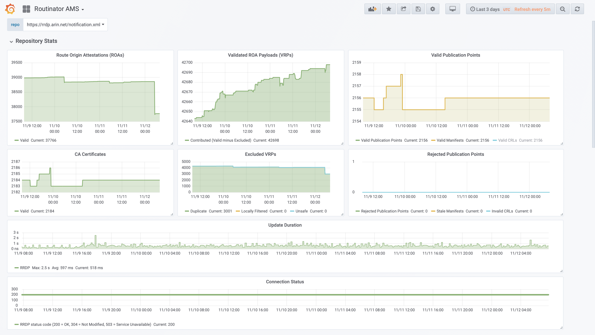
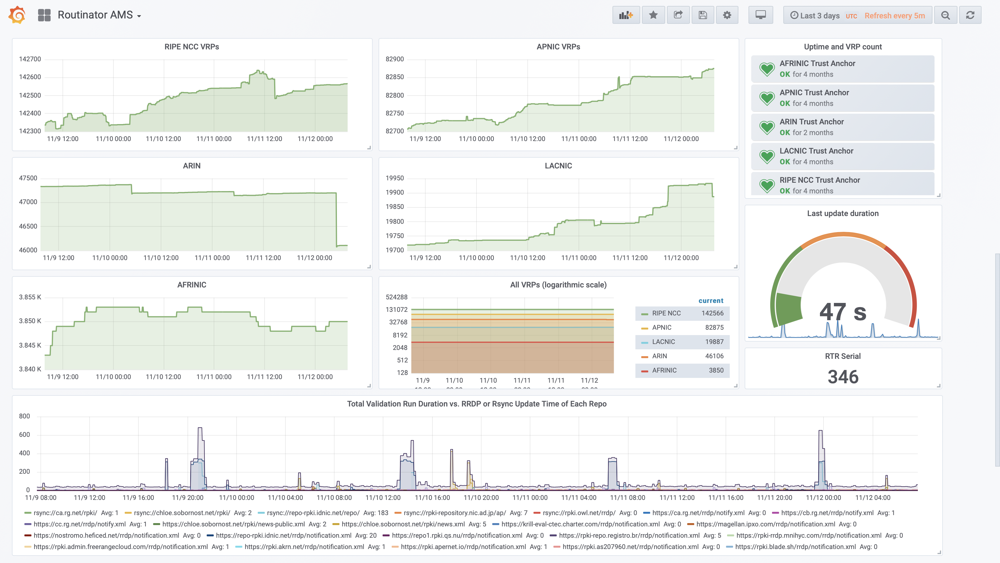

Monitoring
==========

The HTTP server in Routinator provides endpoints for monitoring the
application on the following paths:

``/version``
    Returns the version of the Routinator instance

``/metrics``
    Exposes exhaustive time series data specifically for `Prometheus
    <https://prometheus.io/>`_, containing metrics on all :term:`trust anchors <Trust
    Anchor (TA)>`,
    :term:`repositories <Repository>`, :term:`RRDP <RPKI Repository Delta Protocol
    (RRDP)>` and rsync connections, as well as :term:`RTR <RPKI-to-Router (RPKI-RTR)>` and
    HTTP
    sessions. If desired, dedicated `port 9556
    <https://github.com/prometheus/prometheus/wiki/Default-port-allocations>`_
    is allocated for the exporter.
     
``/api/v1/status``
    Returns exhaustive information in JSON format on all :term:`trust anchors <Trust
    Anchor (TA)>`,
    :term:`repositories <Repository>`, :term:`RRDP <RPKI Repository Delta Protocol
    (RRDP)>` and rsync connections, as well as :term:`RTR <RPKI-to-Router (RPKI-RTR)>` and
    HTTP
    sessions. This data set provides the source for the Routinator user
    interface.

``/status``
    Returns a subset of the metrics information in a concise plain text
    format

Metrics
-------

Update metrics
  - When the last update started and finished
  - The total duration of the last update
  - The retrieval duration and `exit code
    <https://lxadm.com/Rsync_exit_codes>`_ for each rsync :term:`publication point`
  - The retrieval duration and `HTTP status code
    <https://en.wikipedia.org/wiki/List_of_HTTP_status_codes>`_ for each :term:`RRDP <RPKI
    Repository Delta Protocol (RRDP)>`
    :term:`publication point`

Object metrics
  - For each cryptographic object that can appear in the :term:`RPKI <Resource Public Key
    Infrastructure (RPKI)>`, the number of
    valid, invalid and stale items per :term:`trust anchor <Trust Anchor (TA)>` and
    :term:`repository`
  - The number of :term:`validated ROA payloads <Validated ROA Payload (VRP)>`
    (:term:`VRPs <Validated ROA Payload (VRP)>`) per :term:`Trust Anchor <Trust Anchor
    (TA)>` and
    :term:`repository`
  - The number of :term:`VRPs <Validated ROA Payload (VRP)>` added and excluded locally

RTR server
  - The current :term:`RTR <RPKI-to-Router (RPKI-RTR)>` serial number
  - The current number of :term:`RTR <RPKI-to-Router (RPKI-RTR)>` connections
  - The total amount of bytes sent and received over the :term:`RTR <RPKI-to-Router
    (RPKI-RTR)>` connection
  - Metrics for each :term:`RTR <RPKI-to-Router (RPKI-RTR)>` client is available if the
    :option:`--rtr-client-metrics` option is provided
  
HTTP server
  - The current number of HTTP connections
  - The total amount of bytes sent and received over the HTTP connection
  - The number of HTTP requests

  Refer to the Reference section for a complete overview for all metrics in
  the :doc:`JSON format<json-metrics>` and the :doc:`Prometheus
  format<prometheus-metrics>`.

Grafana
-------

Using the Prometheus endpoint it's possible to build a detailed dashboard
using for example `Grafana <https://grafana.com>`_. We provide a `template
<https://grafana.com/grafana/dashboards/11922>`_ to get started.

    Time series for each RPKI Repository

    Time series for each Trust Anchor
